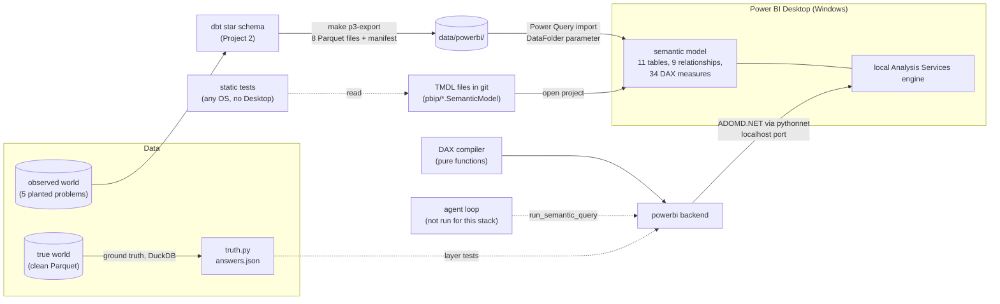
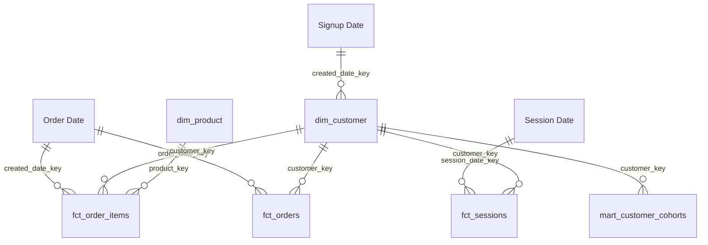

# Project 3: Power BI semantic model as code (PBIP / TMDL)

**Part 3 of 3** in the Klarix Semantic AI Benchmark: a portfolio project that puts three
semantic-layer stacks (BigQuery + Cube Core, dbt Core + MetricFlow, **Power BI**) behind the same
LLM agent interface, on the same frozen, intentionally flawed dataset, and asks the same 20
business questions of each.

> **Status, stated up front.** The Power BI model, the DAX backend and all the tests are built and
> pass against a live Power BI Desktop. **No agent was run against this stack and no LLM was
> called while building it.** This case study is scoped to the semantic layer: it tests the model
> against ground truth, against another engine, and against four common modeling mistakes. It
> contains **no agent pass rates**. Nothing below implies otherwise (see
> [Agent evaluation](#agent-evaluation)).

**Thesis:** a semantic layer makes metric answers *consistent*, but not necessarily *correct*.
The layer is only as correct as the judgment encoded into it.

## The question

Projects 1 and 2 asked this of Cube Core and of dbt with MetricFlow. Project 3 asks it of the tool
many business users already have open: **Power BI**, whose semantic model (tables, relationships,
DAX measures) is the layer between the warehouse and every report.

That deserves its own test, because a Power BI model fails in ways the other two do not:

1. **DAX does not complain.** A filter on a table that cannot reach a measure is silently ignored,
   and a group-by on an unrelated table repeats the same total on every row. MetricFlow and Cube
   raise an error for the same query.
2. **The model is a graph of relationships.** One bidirectional relationship or one measure written
   without the shared base measure can change a number without any visible error.
3. **It is a desktop tool.** The engine that runs the model lives inside Power BI Desktop. Getting
   a model under git, testable without Desktop, and queryable by a program is the real work here.

## Same benchmark, third stack

The frozen data, the planted problems, the 20 questions, the scorers, the judge and the system
prompt are **identical to Projects 1 and 2** and were not changed for this project. The tables in
the model are **Project 2's star schema, exported to Parquet unchanged**, so the semantic layer is
the only variable between Projects 2 and 3.

| | Project 1 | Project 2 | **Project 3** |
|---|---|---|---|
| Warehouse | BigQuery (EU) | DuckDB, one local file | **none at query time**: Parquet files imported into the model |
| Transformation | SQL views applied by a script | dbt Core | dbt Core's star schema, reused (`make p3-export`) |
| Semantic layer | Cube Core (YAML) | MetricFlow (dbt YAML) | **Power BI model, TMDL text files** |
| Metric language | Cube measures | MetricFlow metrics | **DAX measures** |
| Engine | Cube + BigQuery | MetricFlow + DuckDB | **Analysis Services engine inside Power BI Desktop** |
| Runs on | cloud + Docker | any laptop | **Windows with Power BI Desktop** |
| Agent evaluation | run (Gemini and Claude) | stack built, evaluation not run | **stack built, no agent run (scoped to the layer)** |

## Architecture



The agent interface is the same as in the other two projects: `list_metrics`, `list_dimensions` and
`run_semantic_query` against the shared catalog (`shared/semantic/catalog.yaml`: 18 metrics and 15
dimensions, by name, with a time range, filters and a limit). **A language model would never write
DAX.** The backend compiles the catalog query into a `SUMMARIZECOLUMNS` query, runs it on the
local engine and returns the rows under catalog names. For example, "orders in August 2026":

```text
semantic query:  metrics=[orders], time_dimension=order_created, range 2026-08-01..2026-08-31

EVALUATE
SUMMARIZECOLUMNS(
  FILTER(ALL('Order Date'[Date]), 'Order Date'[Date] >= DATE(2026, 8, 1) && 'Order Date'[Date] <= DATE(2026, 8, 31)),
  "orders", [orders]
)
```

The backend finds the engine by itself: Desktop starts one private engine per open project on a
random localhost port and writes the port to a file. Because the database name is a GUID, the
backend recognises the right instance by its tables, and refuses to guess if none or several match.

## Model as code

The Power BI project is saved in PBIP format, with the model as **TMDL** (Tabular Model Definition
Language): one plain-text file per table, plus files for relationships and the model. What that
buys, and what it does not:

**In git, testable without Desktop**
- A measure, a description or a relationship change is a readable diff in a pull request.
- 95 offline tests (any OS, `make p3-static-test`) read the TMDL: tables, relationships, model
  settings, measures, descriptions, the compiler's behaviour on the real model's relationship
  graph, the trap machinery and the runner wiring.
- The data location is a model parameter. The committed value is a placeholder (`__DATA_FOLDER__`),
  `make p3-set-path` writes this machine's path in, and a test fails if a machine path is committed.
- Line endings are fixed to CRLF with `.gitattributes`, because Desktop writes CRLF.

**Still needs Desktop**
- Only the engine can say whether a DAX expression is valid, and what it returns. The 29 live
  tests, the layer tests, the parity run and the traps need Desktop open.
- Desktop reads the TMDL files when the project is opened. A model change on disk shows up in the
  engine after the project is reopened (the Desktop documentation also describes an "apply external
  changes" prompt; I relied on reopening). `make p3-refresh` reloads the data of an open model.
- In a spike on a toy project, Desktop rewrote hand-written TMDL on save: it added a `lineageTag`
  to every object and bumped version numbers. The committed files carry deterministic lineage tags
  so this should not produce a large diff, but I have not compared a Desktop save of the final model.
- The data cache (`cache.abf`) and local settings are gitignored.

## Model design

Eleven tables: seven exported tables, three **role-playing date tables** and one measure table.



All nine relationships are many-to-one, single-direction and active. (`dim_distribution_center`
is loaded but not related: the distribution center name is a column on `dim_product`.)

- **Role-playing date tables.** The star schema has one `dim_date`, but an order date, a signup
  date and a session date are different questions. Instead of inactive relationships and
  `USERELATIONSHIP` in every measure, the model loads the date table three times, one per role
  (`Order Date`, `Signup Date`, `Session Date`). Each drops the unknown member (`date_key = -1`),
  which would otherwise stop Power BI from marking it as a date table, so each has 2,828 days
  (2018-12-04 to 2026-08-31). One consequence: the single customer with an unknown signup date has
  no `Signup Date` row (harmless; `signups` excludes the unknown member).
- **Single-direction relationships only.** A filter flows from a dimension to the facts, never back.
  This is also what makes the backend's reachability rule possible (below), and the T1 trap.
- **A measure-only table.** The 18 catalog measures live on `Metrics`, named and described exactly
  as in the catalog, with a number format by unit (never a percentage: ratios are fractions).
  Implicit measures are discouraged, every column is set to not summarise, auto date/time is off,
  and the key columns, `is_internal` and the whole cohort mart are hidden. The only visible columns
  are the 12 catalog dimension columns and the date grains.
- **Base measures.** Sixteen hidden measures in a `_base` folder each do one aggregation and carry
  the internal-user exclusion. The 18 catalog measures contain no column reference: they wrap a
  base measure or combine measures (`DIVIDE` for ratios, `net_revenue = gross_revenue -
  returned_revenue`). So a business rule is written once.
- **One source for `customer_cohort_month`.** The month of a customer's first order is read from
  `dim_customer`. The mart carries a hidden copy, and a test checks the two agree for every
  customer.

Row counts (the model matches the export manifest, checked live):

| Table | Rows | Table | Rows |
|---|---|---|---|
| `fct_order_items` | 175,804 | `dim_customer` | 97,447 (1,000 internal) |
| `fct_orders` | 119,574 | `dim_product` | 30,858 |
| `fct_sessions` | 663,100 | `mart_customer_cohorts` | 97,446 |
| `dim_distribution_center` | 11 | date tables (x3) | 2,828 each |

Two runs of `make p3-export` give byte-identical manifests. A full refresh of the open model takes
4 to 10 seconds.

## How each planted problem is handled

| # | Problem | Handled by design? | Where |
|---|---|---|---|
| **P1** | "Revenue" is ambiguous: gross includes returned items, net does not | Deliberately **not** resolved. Both measures exist under separate names and each description says what it includes, so the test is whether an agent notices the split | `gross_revenue`, `net_revenue` |
| **P2** | A category is renamed mid-window (Sweaters to Knitwear) | **Yes.** `category_family` on `dim_product` maps both names to one family. Live: Sweaters ends and Knitwear starts in October 2025 (200, 211, then 201, 201 items a month), while the family is one line | `dim_product[category_family]` |
| **P3** | Consent loss nulls the acquisition channel and session source | **Visible, not fixable.** Null becomes an explicit `Unattributed`; `attribution_coverage_rate` drops from about 1.0 to 0.69 to 0.72 from March 2026. The true source is unrecoverable by design | `dim_customer`, `fct_sessions`, `attribution_coverage_rate` |
| **P4** | Synthetic internal accounts inflate order counts and distort the repeat rate | **Yes, on every measure.** Every base measure filters `dim_customer[is_internal] = FALSE()`. A test checks each base measure carries the filter exactly once and a graph walk checks every catalog measure reaches data only through such a measure | base measures, `_base` folder |
| **P5** | A small cohort returns far more items, invisible at whole-channel level | **Structurally.** `customer_cohort_month` is a dimension, so `return_rate` can be sliced by cohort month (checked live). The agent still has to choose to look there | `dim_customer[customer_cohort_month]` |

## Governance in Power BI

**What the static tests guarantee** (all offline, on the TMDL):
- the tables, columns and relationships are exactly the planned ones; every relationship is
  many-to-one, single-direction and active;
- auto date/time is off and no hidden `LocalDateTable_*` exists; implicit measures are discouraged;
  every column is set to not summarise;
- keys and `is_internal` are hidden, and the visible columns are exactly the catalog dimensions;
- the visible measures are exactly the catalog's 18, with the catalog's description verbatim and a
  format by unit; every other measure is hidden, in `_base`;
- the **internal-exclusion convention**: each base measure applies the filter exactly once, and a
  graph walk from every catalog measure fails on a direct column read, an unknown or cyclic
  reference, or a base measure without the filter;
- two DAX pitfalls found later (below): a bare `CALCULATE` filter may only target a hidden column,
  and a ratio's base-measure numerator must be wrapped in `COALESCE(..., 0)`;
- no agent-visible text names a planted problem or its parameters (a hygiene test, run on the TMDL
  and on the live model).

**What the live tests guarantee:** the open model has the same relationships as the files, the same
row counts as the export, serves the catalog's names and descriptions, and refuses what it cannot
answer correctly (next section).

**What none of it proves:** that a definition is *right*. Every static test passes for a
`net_revenue` that forgets to subtract returns. Only the comparison with an independent source of
truth does that, and it is the next section.

**The reachability rule.** The compiler knows, from the relationships and from which tables each
measure reads, whether a requested dimension, filter or time axis can reach a metric. If not, the
whole query is refused with a warning that names the metric and the dimension and lists what does
work, instead of returning a number. This is the answer to DAX not complaining: `sessions` by
`category` would otherwise repeat the total on every category, and `new_customers` filtered by
`category` would silently ignore the filter and return the unfiltered 67,180 (both found live).

## Results: what was measured

All of this ran against Power BI Desktop 2.158.1304.0 with no LLM, and is reproduced by the
`make` targets at the end.

**1. The layer is correct against ground truth.** For every catalog metric, the model's answer over
the full 24-month window is compared with a number recomputed from the clean true world (DuckDB,
separate code). The same suite runs for all three stacks.

| | Checks | Largest deviation from truth | Tolerance |
|---|---|---|---|
| **Power BI** | 41 | `repeat_purchase_rate_90d` **0.22%**; every other check about **4e-15** (floating-point rounding) | 0.5% |
| MetricFlow (Project 2) | 41 | `repeat_purchase_rate_90d` 0.22%; every other check about 1e-15 | 0.5% |
| Cube (Project 1) | 41 | `repeat_purchase_rate_90d` 0.22%, `orders` 0.077%, `purchasing_customers` 0.051%, the rest near exact | 0.5% |

The repeat-rate gap is the same in all three: the shared mart rule ("second order within 90
*calendar days*", so a same-day second order counts) against truth's exact timestamps. It is a
property of the shared mart, not of a layer. `attribution_coverage_rate` has no true-world value
(the true world never loses the data) and is only checked to be a valid ratio below one.

**2. Power BI and MetricFlow agree on the same tables.** 309 queries: every metric over the window
total, each of five time grains, and each of 11 categorical dimensions, plus the layer-test queries.
**257 returned data on both and match value by value, 52 were refused by both, 0 were answered by
only one, 0 differ.** The largest relative difference is 1.1e-14. Three documented differences
between the engines (not errors):

1. **DAX compares text without regard to case.** 2,757 distinct brand strings are 2,718 once case
   is ignored, so Power BI merges `BluePrint` and `Blueprint` into one group (and a `brand` filter
   matches both), where SQL keeps two. The comparison adds MetricFlow's variants up for additive
   metrics.
2. **Empty groups.** `SUMMARIZECOLUMNS` drops a group where every requested measure is blank;
   MetricFlow's `GROUP BY` lists it with null or zero (`gross_revenue` by `item_status` has no
   `Cancelled` row in Power BI). An ungrouped query over an empty slice still returns one row of
   `None`.
3. **Blank versus zero.** DAX returns BLANK for every measure on an empty context, counts
   included; the backend returns `None` for all of them. MetricFlow returns 0 for the four
   distinct-count metrics (`orders`, `purchasing_customers`, `signups`, `sessions`) and null for the
   rest. I did not check Cube's behaviour.

**3. The backend refuses what it cannot answer.** 52 of the 309 sweep queries are refused by both
layers, because the dimension cannot reach the metric. Query refusal is tested offline against the
real relationship graph and live.

## Power BI traps

Four common modeling mistakes, each switched on **inside one query** (a `DEFINE MEASURE` or raw
DAX) or in a throwaway copy of the TMDL. The committed model is never changed. `make p3-traps` runs
the real tests twice, on the correct model and with the trap on, and a catcher counts only if it
goes from passing to failing. Window 2024-09-01 to 2026-08-31.

| Trap | Query | Wrong | Truth | Deviation | Caught by |
|---|---|---|---|---|---|
| **T1** Bidirectional relationship | every query the backend accepts (261 x 7 candidate relationships) | unchanged | | **0 queries moved** | static test (relationships are single-direction) |
| **T2** `orders` without the base measure | `orders`, Aug 2026 | 5,026 | 4,633 | +8.5% | static graph walk; layer test |
| | `orders`, full window | 62,771 | 58,782 | +6.8% | (same) |
| **T3a** Summed ratio | `return_rate`, full window | 2.7581 | 0.1147 | +2304% | 2 static tests; layer test |
| **T3b** Averaged ratio | `return_rate`, full window | 0.1149 | 0.1147 | +0.2% | 2 static tests; **the layer test does not catch it** |
| **T3c** Implicit measure | `SUM(sale_price)`, Aug 2026 | 457,776 | 382,760 | +19.6% | 2 static tests |
| **T4** Unrelated group-by | `sessions` by `category`, sum of rows | 18,566,800 | 663,100 | 28x (the total on 28 rows) | compiler and contract tests, once the guard is disabled |

Why each happens:
- **T1.** A filter on a fact column would also narrow the customer table, and through it every
  other fact table, so a customer count answers a question about items. **On this data no query
  the backend accepts changed**, because the reachability rule already stops queries that rely on a
  path the model lacks. It does change queries the correct model refuses: `signups` by `category`
  goes from the total repeated to per-category counts summing to 155,401 for 96,446 customers. I
  did not tune anything to make it move; only the static test catches it.
- **T2.** The 1,000 internal accounts are customers like any other; only the exclusion in the base
  measure removes them. A measure written straight on the table bypasses it.
- **T3a, T3b.** A ratio is not additive. The plain average of 24 monthly return rates lands within
  0.2% of the true rate on this data, so it passes the layer test while the definition is still
  wrong. Nothing in the repository checks a monthly grain against truth.
- **T3c.** A raw `SUM` does not know cancelled items are not revenue or that internal accounts are
  not customers.
- **T4.** `dim_product` filters `fct_order_items`, not `fct_sessions`, so DAX repeats the total.

One limit of the method: a `DEFINE MEASURE` replaces a measure only where the query names it, and
another measure that refers to it keeps the model's version. So T2 and T3 replace the catalog
measure itself, and no `aov` catcher is claimed. Auto date/time is a model setting, not a fifth
trap: it adds hidden date tables but changes no number here.

## Agent evaluation

**No agent runs were made for this stack.** This case study is scoped to the semantic layer, so it
reports no agent pass rates, and none should be inferred.

What is in place:
- the `powerbi` backend is registered in the shared eval runner and serves the same metric contract
  (`make eval BACKEND=powerbi PROVIDER=anthropic` starts, finds Desktop, and stops with a one-line
  message if Desktop is not open; a test covers that without calling any model);
- the language model never writes DAX: the backend compiles it;
- the same 20 questions, scorers and judge apply, unchanged;
- `config/runs.yaml` has a `project3` block with null pins.

Why the study stops at the layer: the agent harness is the same for every stack, and its behaviour
on a governed layer is measured in [Project 1](../project1-gcp-cube/). What is specific to Power BI
is the model: relationships, DAX and model settings. That is where this study puts its tests. A
layer that cannot be shown correct against truth is not ready for an agent, whatever the agent's
score.

## Three stacks, same benchmark

These come from building the layer a third time and from the layer-level tests. They are **not**
agent findings.

- **Power BI is the quietest of the three when a query is wrong.** MetricFlow raises an error for
  a dimension a metric cannot reach and Cube refuses a fact-to-fact join; DAX returns a number. A
  Power BI backend therefore needs its own reachability check, and the model alone is not a safe
  interface for a program.
- **All three layers reach truth to the same limit.** The same 41 checks pass in all three, and the
  one visible gap (0.22%) is a shared mart rule, so the differences between stacks are not in the
  headline numbers.
- **A convention is only as safe as its test.** Internal-user exclusion is a per-measure filter in
  all three stacks (Power BI has no model-wide default segment either). Each needs a test that
  walks the measure graph.
- **Building it twice found bugs the tests alone did not.** The cross-engine sweep found two real
  model bugs, below. They were invisible to the 18-measure truth check because they only show up
  when grouped.
- **Where a metric lives matters little for the answer, a lot for the model.** Defining `orders`
  on order items (as Power BI and MetricFlow do) is exact against truth; Cube's orders-table
  definition is off by up to 0.08%.
- **"Model as code" is half true in Power BI.** The text files are real and testable; the engine
  that runs them is not available without Desktop, and it only sees a change after a reopen.

## Engineering findings

Each was found while building, not from the documentation.

| Symptom | Cause and fix |
|---|---|
| The backend cannot find the engine | The Store build writes its port file under the user profile (`...\Microsoft\Power BI Desktop Store App\AnalysisServicesWorkspaces\<guid>\Data\msmdsrv.port.txt`), not under `%LOCALAPPDATA%`, as UTF-16 text. The installer build's location is documented but untested here |
| Which of several open projects is ours? | The database name is a GUID. Identify the instance by its tables, and refuse to guess if none or several match |
| A filter on a table that cannot reach the measure is ignored (`new_customers` by `category` returned the unfiltered 67,180) | DAX does not error. The compiler's reachability rule refuses the query with a warning |
| `attribution_coverage_rate` by channel returned 24.5 for "Display" | `CALCULATE` with a bare filter on `acquisition_channel` *replaces* the query's own group-by on that column. Wrapped in `KEEPFILTERS`; a static test now allows a bare filter only on a hidden column |
| A group with sessions but no conversions vanished instead of showing 0 | `DIVIDE(BLANK, n)` is BLANK. The five ratios with a base-measure numerator now wrap it in `COALESCE(..., 0)`; the denominator stays blank when there is no data |
| "Mark as date table" is rejected | `dim_date` has an unknown member (`date_key = -1`, null date). The three role-playing date tables drop it in Power Query |
| A `DEFINE MEASURE` of a hidden base measure changes nothing | Other model measures keep referring to the model's version. Override the measure the query names |
| Brand group counts differ from SQL | DAX text comparison is case-insensitive (2,757 strings, 2,718 distinct). Documented; the comparison sums the case variants |
| A model edited on disk is not what the engine shows | Desktop reads TMDL when the project is opened; a window opened before a change predates it. Reopen, then `make p3-refresh` |
| `INFO.VIEW.MEASURES()` returns no format string for a custom format | It reports `FormatStringDefinition` for a string literal; the unit is read from `INFO.MEASURES()` instead |
| A regex in a patch script silently matched nothing | A backslash-b typed through a Windows heredoc became a backspace character. Check files for `chr(8)` or edit such lines directly |
| A Windows path over 260 characters breaks PBIP saves | Keep the project path short |
| `pythonnet` works only on the .NET Framework runtime here | `load("netfx")` with the net472 build of ADOMD.NET; the .NET Framework ships with Windows. The DLL is downloaded by a script against a pinned SHA-256 and never committed |

## Honest limitations

- **Windows and Power BI Desktop only.** The backend needs a running Desktop with the project open.
  Only the Microsoft Store build (2.158.1304.0) was used; the installer build's port-file location
  is documented but not tested.
- **An import snapshot, not DirectQuery.** The model holds a copy of the Parquet files in memory.
  Nothing here says how the model behaves against a live warehouse.
- **No Power BI service or Fabric behaviour was tested.** Not deployment, refresh schedules,
  row-level security, nor the service's own query limits.
- **The layer test checks window totals.** A mistake that moves a total by less than 0.5% passes
  (T3b). No test checks monthly numbers against truth.
- **P3 is unrecoverable by design.** The layer can only make the lost source visible.
- **Project 1 leaks a planted-problem label to the agent.** Its Cube description of
  `attribution_coverage_rate` says "P3 (consent-tracking loss)", and that text reached the agent in
  Project 1's runs. Project 1 is frozen, so it is not fixed; the hygiene test marks it as an
  expected failure. Project 3's descriptions pass, in the TMDL and in the live model.
- **No agent was run**, so nothing here shows whether the Power BI model helps an agent.
- **Versions are pinned and Microsoft-owned parts are not redistributed.** `pythonnet` 3.2.1,
  ADOMD.NET 19.117.0 (downloaded, gitignored). Power BI Desktop and ADOMD.NET are Microsoft
  software under their own licenses; check them before reusing this outside a personal project.

## Privacy

Everything runs locally on Windows. No LLM is called in this project, and the queries and results
stay on the machine: the backend talks to a localhost port. The data is Google's public, synthetic
`thelook_ecommerce` dataset, so there is no real customer data at any point. Power BI Desktop is
Microsoft software with its own diagnostic settings, which I did not inspect.

## Reproduce it

The frozen snapshot (`data/`) is not in git, and re-pulling the public dataset would change the
numbers. These steps rebuild everything downstream of it.

```sh
make setup                  # uv sync, including the project2 and project3 dependency groups
make world                  # true / observed / truth (deterministic from the seed)
make p2-build               # Project 2's dbt star schema (the input to the export)
make p3-setup               # ADOMD.NET download (pinned SHA-256) into a gitignored folder
make p3-export              # star schema -> data/powerbi/*.parquet + manifest.json
make p3-static-test         # TMDL, compiler, traps machinery and wiring tests: any OS, no Desktop
make p3-set-path            # write this machine's data folder into the model parameter
```

Manual Desktop steps:

1. Open `project3-powerbi-tmdl/pbip/KlarixApparel.pbip` in Power BI Desktop (Windows). Keep
   exactly one window with this project open.
2. Refresh: in Desktop, or `make p3-refresh`.
3. Optional: build the three-visual page ([REPORT_PAGE.md](REPORT_PAGE.md)).

```sh
make p3-live-test           # live: row counts, relationships, contract
make p3-layer-test          # live: 41 checks against truth (deviation summary at the bottom)
make p3-parity              # live: Power BI vs MetricFlow, writes runs/powerbi_parity.md
make p3-traps               # live: the traps table, writes runs/powerbi_traps.md
make test && make lint      # the whole suite; live tests skip without Desktop or Cube
uv run python project3-powerbi-tmdl/set_data_path.py --reset   # before committing
```

Never run for this project: `make eval BACKEND=powerbi ...`.

## What to screen-record

1. `make p3-static-test`: the offline tests passing, no Desktop.
2. Opening the PBIP in Desktop, then a measure's description in the fields pane (the catalog text).
3. `make p3-layer-test`: the deviation summary (about 4e-15 everywhere except the one explained
   0.22%).
4. `make p3-traps`: the table, with each catcher flipping from passed to failed.
5. The three-visual report page ([REPORT_PAGE.md](REPORT_PAGE.md)): the break, the continuous line,
   the coverage drop.
6. One compiled DAX query next to its semantic query: for example `run_semantic_query` for
   `orders` in August 2026 and its `compiled_query` (shown above under Architecture).
